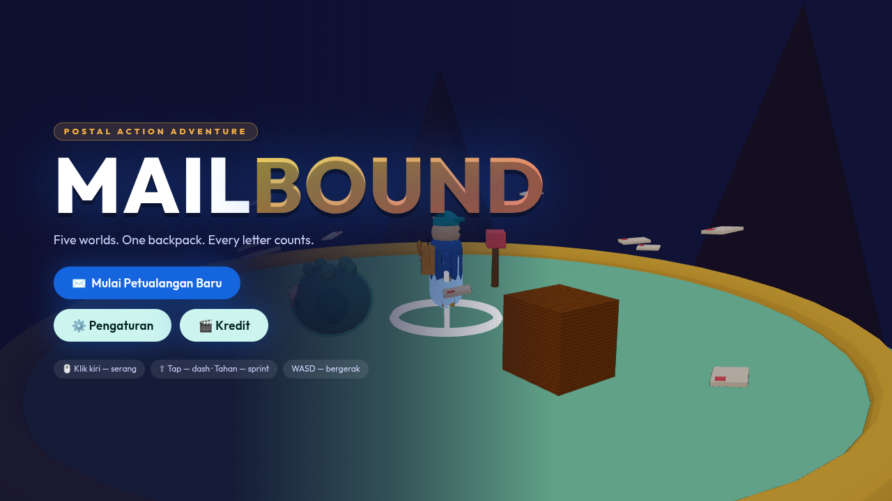
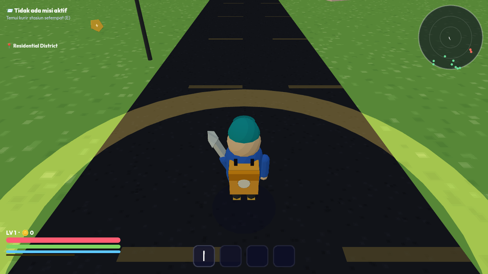

# MAILBOUND 📬❄️
> A 3D mail-delivery action-adventure. Five worlds, one backpack, every letter counts.
> Built **end-to-end in this repo** with zero binary assets — everything is procedural.





## Quick start

```bash
npm install
npm run dev        # dev server → http://localhost:5173
npm run build      # production build → dist/
npm run preview    # production server → http://localhost:4173
```

**Node 20+** required. On this machine the game is already served at `http://127.0.0.1:4173/`.

## How to play

Third-person, pointer-locked action-adventure.

| Input | Action |
|---|---|
| **WASD** | Move (camera-relative) |
| **Mouse** | Camera rotation (pointer lock) · click once to capture |
| **LMB** | Combo attack (3-hit chain) |
| **RMB** | Lock-on toggle |
| **Space** | Jump (coyote-time + input buffer) |
| **Shift tap** | Dash (cooldown, i.e. dedicated dash!) |
| **Shift hold** | Sprint (drains stamina) |
| **1 / 2 / 3 / 4** | Skills: Quick Slash · Spinning Blade · Shadow Dash · Courier Strike |
| **E** | Interact / speak / deliver |
| **Esc** | Pause / back out |

## The game in one line per pillar

- **Long play** — 5 worlds (Residential → Metropolis → Theme Park → Wild Forest → Coastal Paradise), each with 5–8 missions (corrupt chain + sides), 8 NPCs each (**40 unique villagers**), 8 hidden golden stamps per world, 8 secret items from NPCs, side elite enemy, one colossal slime boss at the end.
- **Hack-and-slash combat** — 3-hit combo, dash attack, air plunge, 4 active skills with cooldowns & energy cost, lock-on, knockback, i-frames, floating damage numbers.
- **Mail-first loop** — accept missions from local NPCs, marker pillar guides you, fragile/timed/multi deliveries, pay, get XP.
- **Secret items** — talk to/bring stamps to NPCs to unlock 8 unique relics that permanently buff the run (attack, dodge, dash, HP regen, reveal radius…).
- **Cinematic travel** — finish a world → the MAILWING jet lands → takeoff cinematic → world card → next world.
- **The finale** — Coastal Paradise: boss **UYEHH, the Jelly Slime** — adorable, poisonous, relentless. Three phases, belly-exposure weak point, goo minions, enrage.

## Architecture at a glance

```
Three.js ── renders the real 3D world (cel-toon + full outlines)
Phaser 3 ── game loop, scene orchestration, HUD canvas layer
DOM/CSS  ── Material Design 3 menus & dialogs (fully modular)
Web Audio── procedural OST + SFX (no files)
Canvas 2D── every texture drawn in code (no binary assets)
```

Full breakdown: [`docs/ARCHITECTURE.md`](docs/ARCHITECTURE.md)
Content bible (worlds, NPCs, secrets, boss, credits): [`docs/CONTENT.md`](docs/CONTENT.md)

## Controls & systems that matter

- **Save system** — `localStorage` keys `mailbound-save-v2` (game state) and `mailbound-settings-v1` (options). Versioned, migrates forward, wiped cleanly from the menu if desired.
- **Quality switch** — Low / Medium / High (render ratio) via Settings, saved instantly.
- **Skill unlocks** — Quick Slash (L1), Spinning Blade (L3), Shadow Dash (L5), Courier Strike (L7).
- **Quality-of-life** — pointer lock auto-pause, coyote-jump, combo chaining, auto-step stair/crates, camera arm pull-in, dodge roll from secret items.

## Project layout (modular by design)

```
src/
├── core/         # App singleton, constants, versioning, game flow
├── render3/      # Renderer3D host, cel-shading + outline pipeline,
│                   models/props/effects — ALL procedural
├── worlds/       # WorldBase (scene/colliders/props) + World1..5 data + index
├── player/       # Player entity + controller + combat + skills + stats
├── enemies/      # Enemy base, AI FSM, manager/spawner, projectile pool
├── npc/          # NPC + manager
├── systems/      # Input, Save, Audio (synth OST+SFX), Camera, Items
├── combat/       # Hitbox queries, Damage rules, combat orchestration
├── delivery/     # Mission offers → markers → completion chain
├── dialogue/     # Typewriter panel, mission & secret-item handoff
├── vehicles/     # JetController: inbound → parked → takeoff
├── ui/           # UIRoot (DOM overlays) + screens/* (MD3 screens)
├── scenes/       # Boot, Loading, MainMenu, World, HUD, Transition
└── styles/       # MD3 tokens + per-screen modular CSS
```

## Credits (in-game too, of course)

**ARIF ALEXANDER** — developer, designer, tester, analyze, marketing, customer service, editor, script writer, dubber, research, accountant, business development.

See the in-game **Credits** screen (menu → Kredit) for the full ceremonial role call.

## Heads-up on the environment

- This project is a **front-end game** — not a lerd PHP site. It can run anywhere Node 20+ and a modern browser do (`npm run dev`).
- The `.lerd.yaml`-aware serving story would be `npm run build` then serve `dist/` statically; lerd *itself* has no opinion about Vite unless you add a custom worker.
